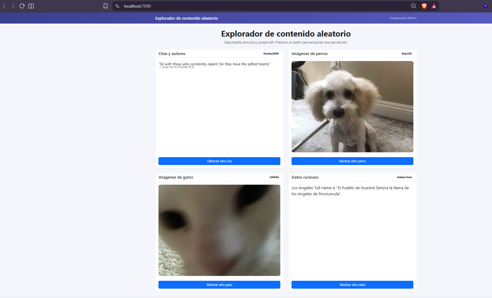
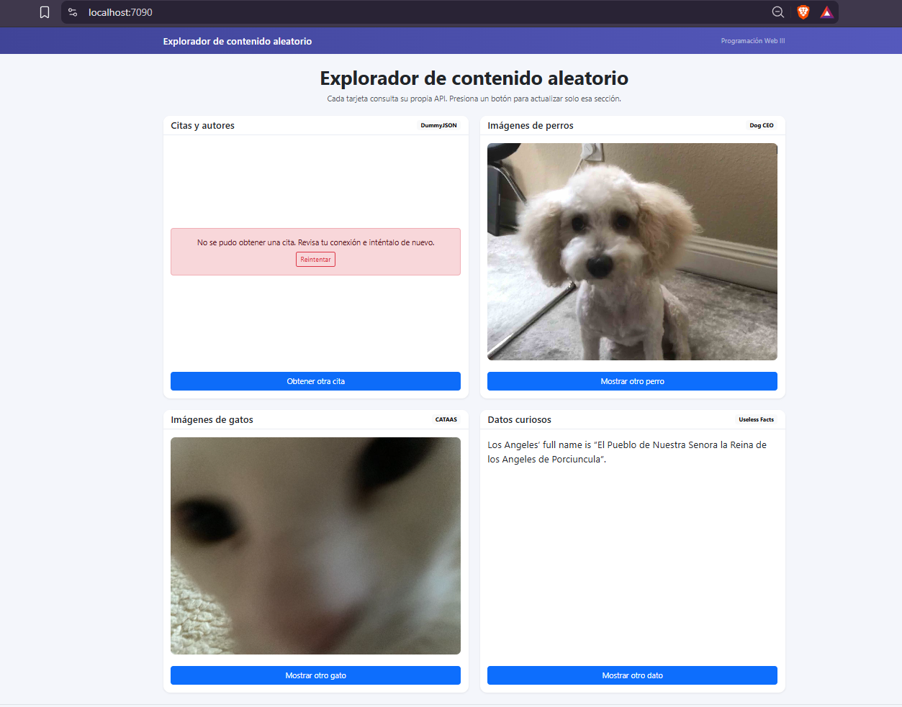

# Explorador de contenido aleatorio

Programación Web III · ASP.NET Core MVC (.NET 10) · HTML, CSS, JavaScript y Bootstrap

Repositorio: https://github.com/sebaxtianmur89/ExploradorContenido

## Integrante

- Angel Eguez Mur

## Descripción

Página con cuatro tarjetas que consumen APIs públicas usando `fetch` y `async/await`:

| Sección | API | Campo usado |
|---|---|---|
| Citas y autores | DummyJSON | `quote`, `author` |
| Imágenes de perros | Dog CEO | `message` (URL de la imagen) |
| Imágenes de gatos | CATAAS | `id` → `https://cataas.com/cat/{id}` |
| Datos curiosos | Useless Facts | `text` |

Al abrir la página se cargan las cuatro secciones. Cada botón vuelve a consultar
solo su propia API, muestra “Cargando…”, se deshabilita mientras la solicitud
está en curso y se vuelve a habilitar al terminar (también si hay error). Si una
consulta falla, la tarjeta muestra un mensaje y un botón **Reintentar**; las demás
tarjetas siguen funcionando.

## Estructura

```
ExploradorContenido/
├── ExploradorContenido.slnx
└── ExploradorContenido/
    ├── Controllers/HomeController.cs     → devuelve la vista principal
    ├── Views/Home/Index.cshtml           → HTML de las 4 tarjetas
    ├── Views/Shared/_Layout.cshtml       → plantilla con Bootstrap
    ├── wwwroot/css/explorador.css        → estilos (separados del HTML)
    └── wwwroot/js/explorador.js          → lógica de las 4 APIs (separada del HTML)
```

## Instrucciones de ejecución

Requisitos: SDK de .NET 10 y conexión a Internet.

**Con Visual Studio:** abrir `ExploradorContenido.slnx` y presionar ▶ (perfil `https`).

**Con la terminal / VS Code:**

```bash
cd ExploradorContenido
dotnet build
dotnet run --launch-profile https
```

Luego abrir `https://localhost:7090` en el navegador.

## Preguntas de reflexión

### 1. ¿Qué es un endpoint y cuál utilizaste para cada API?

Un endpoint es una dirección URL concreta de una API a la que se envía una
solicitud (en este caso con el método GET) para obtener un recurso específico.
Los endpoints utilizados fueron:

- Citas: `https://dummyjson.com/quotes/random`
- Perros: `https://dog.ceo/api/breeds/image/random`
- Gatos: `https://cataas.com/cat?json=true` (JSON) y luego `https://cataas.com/cat/{id}` para la imagen
- Datos curiosos: `https://uselessfacts.jsph.pl/api/v2/facts/random?language=en`

### 2. ¿Qué diferencia existe entre recibir JSON y recibir directamente una imagen?

Un JSON es texto con datos estructurados (por ejemplo `{ "id": "...", "url": "..." }`)
que se convierte en un objeto de JavaScript con `response.json()` para leer sus
campos. Una imagen, en cambio, es un archivo binario (JPG, PNG, GIF): no se puede
leer con `response.json()` porque no es texto JSON y daría error. Por eso, en la
sección de gatos primero se pide `cat?json=true` para obtener el identificador y
después esa URL de imagen (`/cat/{id}`) se asigna directamente al atributo `src`
de un ``, para que el navegador la descargue y la muestre.

### 3. ¿Qué función cumplen `await` y `response.json()`?

`fetch` devuelve una promesa, es decir, un resultado que llegará más tarde.
`await` pausa la función `async` hasta que esa promesa se resuelva, sin bloquear
el resto de la página, y permite escribir el código en orden como si fuera
secuencial. `response.json()` lee el cuerpo de la respuesta y lo convierte de
texto JSON a un objeto de JavaScript; también devuelve una promesa, por eso se
usa con `await`.

### 4. ¿Por qué se debe verificar `response.ok` además de utilizar `try/catch`?

`fetch` solo lanza una excepción cuando hay un fallo de red (por ejemplo, sin
Internet o el servidor no responde). Si el servidor contesta con un error HTTP
como 404 o 500, `fetch` lo considera una respuesta válida y **no** entra al
`catch`. Al revisar `response.ok` (verdadero solo para códigos 200–299) y lanzar
un error cuando es falso, esos casos también se manejan en el `catch` y se muestra
el mensaje al usuario en lugar de intentar leer datos que no existen.

### 5. ¿Cómo lograste actualizar una sección sin recargar toda la página?

Cada sección tiene su propia función (`obtenerCita`, `obtenerPerro`,
`obtenerGato`, `obtenerDatoCurioso`) asociada a su botón con
`addEventListener("click", ...)`. Al presionar el botón, la función hace la
consulta con `fetch` en segundo plano y luego modifica solo los elementos de esa
tarjeta mediante el DOM (`textContent` para el texto y `src` para la imagen),
buscándolos por su `id`. Como no se envía ningún formulario ni se navega a otra
URL, el navegador no recarga la página y las demás tarjetas quedan intactas.

## Capturas

Las cuatro secciones funcionando:



Mensaje de error controlado (Internet desconectado al pedir una nueva cita):


